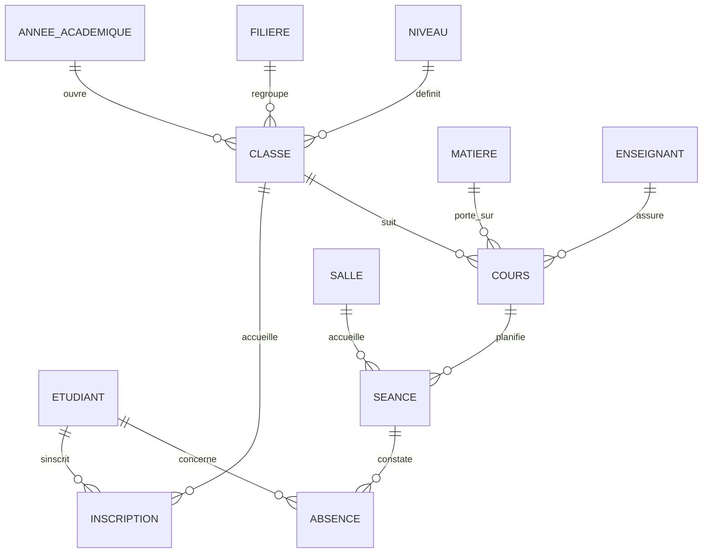

# GestionUniversite


Application de bureau de gestion d'une université : inscriptions, classes et cours, planification des séances, absences, statistiques, impression et export. Développée en C# (Windows Forms, .NET 8) au-dessus d'une base SQL Server, avec une interface aux couleurs de l'école, un mode clair et un mode sombre.

Projet réalisé dans le cadre du cours de Base de Données II (IIT, L2).

## Aperçu

| Connexion | Tableau de bord |
|---|---|
|  |  |

| Statistiques | Planification (calendrier) |
|---|---|
|  |  |

| Étudiants | Inscriptions |
|---|---|
|  |  |

| Absences | Mode sombre |
|---|---|
|  |  |

## Fonctionnalités

**Authentification et comptes**
- Connexion par e-mail et mot de passe, seuls les utilisateurs présents en base sont autorisés
- Mots de passe stockés sous forme de hash SHA-256
- Gestion des utilisateurs (rôles Administrateur, Scolarité, Enseignant) et changement de son propre mot de passe

**Tableau de bord**
- Bannière d'accueil, chiffres clés, graphiques (inscriptions par filière, statut des inscriptions, effectif par classe)
- Prochaines séances et dernières inscriptions

**Statistiques**
- Inscriptions par filière et par niveau, statuts, répartition femmes / hommes, effectifs, absences par matière
- Taux de validation, frais encaissés, séances planifiées
- Impression ou PDF de la page

**Gestion**
- Étudiants : liste, recherche en direct, création, modification, suppression
- Inscriptions : création, validation, annulation, reçu d'inscription imprimable ou en PDF
- Classes et cours : création des classes, association des matières et des enseignants, liste de classe imprimable
- Planification : calendrier hebdomadaire coloré par type de séance (CM, TD, TP) ou vue en liste, refus automatique des conflits de salle, d'enseignant et de classe, et des salles trop petites
- Absences : feuille d'appel par séance, enregistrement en une seule transaction, feuille d'appel imprimable avec signatures

**Référentiels**
- Enseignants, matières, salles
- Structure académique : filières, niveaux et années académiques (une seule année active)

**Outils transversaux**
- Export CSV (s'ouvre directement dans Excel) de toutes les listes
- Impression avec aperçu et export PDF (via l'imprimante Windows « Microsoft Print to PDF »)
- Mode clair et mode sombre, choix conservé entre deux ouvertures
- Page Paramètres : apparence, nom de l'établissement, compte, test de la connexion à la base

## Technologies

| Domaine | Choix |
|---|---|
| Langage | C# |
| Interface | Windows Forms (.NET 8), composants dessinés sur mesure |
| Icônes | FontAwesome.Sharp |
| Base de données | SQL Server |
| Accès aux données | Microsoft.Data.SqlClient, procédures stockées et requêtes paramétrées |

## Architecture

Trois couches dans un seul projet :

```
GestionUniversite/
├── Database/                 Scripts SQL (à exécuter dans l'ordre)
│   ├── 01_schema.sql
│   ├── 02_sp_etudiant.sql
│   ├── 03_ecrans.sql
│   └── 04_ecrans_suite.sql
├── docs/screenshots/         Captures d'écran du README
└── GestionUniversite/
    ├── Models/               Classes métier (une par table)
    ├── DataAccess/           DAO, connexion et accès aux données
    ├── Resources/            Logo et images de l'école
    ├── UInterface/           Fenêtres (Frm...) et pages (Uc...)
    │   └── Composants/       Cartes, boutons, grille, graphiques, calendrier
    └── Program.cs
```

- Les écrans de gestion sont des `UserControl` (`Uc...`) chargés dans la fenêtre principale `FrmMain`.
- Les fenêtres de saisie sont des `Form` (`Frm...Detail`).
- Les colonnes des grilles sont définies dans le designer, donc visibles sans lancer l'application.
- Le thème (clair ou sombre) s'applique grâce à la propriété `Tag` de chaque contrôle, gérée par la classe `Theme`.

## Base de données

Base `dbGestionUniversite`.



Tables : AnneeAcademique, Filiere, Niveau, Classe, Etudiant, Inscription, Enseignant, Matiere, Cours, Salle, Seance, Absence, Utilisateur.

### Règles de gestion appliquées par la base

| Règle | Mise en oeuvre |
|---|---|
| Un étudiant ne s'inscrit qu'une fois par année | Contrainte `UNIQUE (idEtudiant, idAnnee)` |
| L'année de l'inscription est celle de la classe | Clé étrangère composée `(idClasse, idAnnee)` |
| Une seule année académique active | Index unique filtré sur `estActive` |
| Une salle n'accueille pas deux séances simultanées | Trigger `TR_Seance_Controles` (erreur 50001) |
| Un enseignant ne donne pas deux séances simultanées | Trigger `TR_Seance_Controles` (erreur 50002) |
| Une classe n'a pas deux séances simultanées | Trigger `TR_Seance_Controles` (erreur 50003) |
| La salle doit couvrir l'effectif de la classe | Trigger `TR_Seance_Controles` (erreur 50004) |
| Une absence concerne un étudiant inscrit dans la classe | Trigger `TR_Absence_EtudiantDansClasse` (erreur 50005) |

## Installation

### Prérequis
- Windows 10 ou 11
- Visual Studio 2022 ou plus récent, avec la charge de travail « Développement de bureau .NET »
- SQL Server (Express suffit) et SQL Server Management Studio

### Étapes
1. Cloner le dépôt :
   ```bash
   git clone https://github.com/itsketii/GestionUniversite.git
   ```
2. Dans SSMS, exécuter dans l'ordre les scripts du dossier `Database/`.
3. Ouvrir `GestionUniversite.sln` dans Visual Studio. Les paquets NuGet (`Microsoft.Data.SqlClient`, `FontAwesome.Sharp`) sont restaurés automatiquement.
4. Dans `GestionUniversite/DataAccess/DbConnexion.cs`, adapter le nom du serveur :
   ```csharp
   public const string Serveur = @"localhost\SQLEXPRESS";
   ```
5. Générer la solution (Ctrl+Maj+B) puis lancer l'application (F5).

### Compte de départ

| E-mail | Mot de passe |
|---|---|
| admin@iit.ci | Admin@2026 |

À changer dès la première utilisation (Paramètres, Changer mon mot de passe).

### Impression et PDF
L'export PDF utilise l'imprimante Windows « Microsoft Print to PDF », présente par défaut sur Windows 10 et 11. L'aperçu avant impression permet aussi d'imprimer sur papier.

> `01_schema.sql` supprime et recrée la base `dbGestionUniversite` à chaque exécution. Ne le relancer qu'en connaissance de cause.

## Feuille de route

- [x] Modélisation (MCD, MLD) et script SQL Server
- [x] Connexion, tableau de bord, statistiques
- [x] Étudiants, inscriptions, classes et cours, planification, absences
- [x] Référentiels : enseignants, matières, salles, structure académique, utilisateurs
- [x] Export CSV, impression, PDF, mode sombre, paramètres
- [ ] Photos des étudiants
- [ ] Gestion des droits selon le rôle de l'utilisateur
- [ ] Import d'étudiants depuis un fichier Excel

## Équipe

| Membre | Rôle |
|---|---|
| [Membre 1] | |
| [Membre 2] | |
| [Membre 3] | |
| [Membre 4] | |

## Licence

Projet pédagogique, tous droits réservés à l'équipe.
