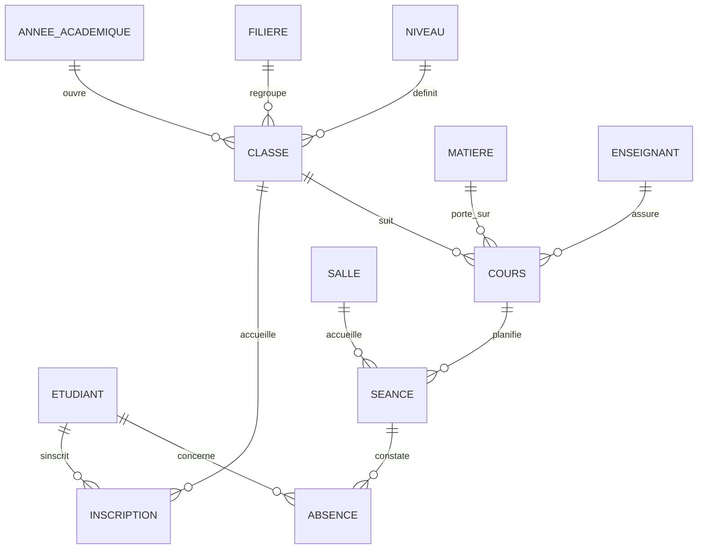

# GestionUniversite


Application de bureau de gestion d'une université : inscriptions des étudiants, planification des cours et suivi des absences. Développée en C# (Windows Forms, .NET 8) au-dessus d'une base SQL Server, avec une interface aux couleurs de l'école.

Projet réalisé dans le cadre du cours de Base de Données II (IIT, L2).

## Aperçu

| Connexion | Tableau de bord |
|---|---|
|  |  |

| Étudiants | Inscriptions |
|---|---|
|  |  |

| Classes | Planification |
|---|---|
|  |  |

| Absences |
|---|
|  |

## Fonctionnalités

**Authentification**
- Connexion par e-mail et mot de passe, seuls les utilisateurs présents en base sont autorisés
- Mots de passe stockés sous forme de hash SHA-256

**Tableau de bord**
- Étudiants inscrits, classes ouvertes, séances des 7 prochains jours, absences non justifiées
- Prochaines séances et effectif par classe

**Étudiants**
- Liste avec recherche en direct, création, modification (double-clic) et suppression

**Inscriptions**
- Inscription d'un étudiant dans une classe de l'année active, avec frais
- Validation et annulation d'une inscription

**Classes et cours**
- Création de classes (filière, niveau, année académique)
- Association des matières et des enseignants à chaque classe

**Planification des cours**
- Vue des séances par semaine, filtrable par classe
- Planification et annulation de séances (CM, TD, TP)
- Refus automatique des conflits de salle, d'enseignant et de classe, et des salles trop petites

**Absences (bonus)**
- Feuille d'appel par séance : absent, justifiée, motif
- Enregistrement de l'appel complet en une seule transaction

## Technologies

| Domaine | Choix |
|---|---|
| Langage | C# |
| Interface | Windows Forms (.NET 8) |
| Base de données | SQL Server |
| Accès aux données | Microsoft.Data.SqlClient, procédures stockées |
| Icônes | FontAwesome.Sharp (prévu pour la finition) |

## Architecture

Trois couches dans un seul projet :

```
GestionUniversite/
├── Database/                 Scripts SQL (à exécuter dans l'ordre)
│   ├── 01_schema.sql
│   ├── 02_sp_etudiant.sql
│   ├── 03_ecrans.sql
│   └── 04_ecrans_suite.sql
├── docs/screenshots/         Captures d'écran du README
└── GestionUniversite/
    ├── Models/               Classes métier (une par table)
    ├── DataAccess/           DAO, connexion et accès aux procédures stockées
    ├── UInterface/           Formulaires (Frm...) et pages (Uc...)
    │   └── Composants/       PanelArrondi, BoutonArrondi, GrilleModerne
    └── Program.cs
```

- Les écrans de gestion sont des `UserControl` (`Uc...`) chargés dans la fenêtre principale `FrmMain`.
- Les fenêtres de saisie sont des `Form` (`Frm...Detail`).
- Les colonnes des grilles sont définies dans le designer, donc visibles sans lancer l'application.

## Base de données

Base `dbGestionUniversite`.



Tables : AnneeAcademique, Filiere, Niveau, Classe, Etudiant, Inscription, Enseignant, Matiere, Cours, Salle, Seance, Absence, Utilisateur.

### Règles de gestion appliquées par la base

| Règle | Mise en oeuvre |
|---|---|
| Un étudiant ne s'inscrit qu'une fois par année | Contrainte `UNIQUE (idEtudiant, idAnnee)` |
| L'année de l'inscription est celle de la classe | Clé étrangère composée `(idClasse, idAnnee)` |
| Une seule année académique active | Index unique filtré sur `estActive` |
| Une salle n'accueille pas deux séances simultanées | Trigger `TR_Seance_Controles` (erreur 50001) |
| Un enseignant ne donne pas deux séances simultanées | Trigger `TR_Seance_Controles` (erreur 50002) |
| Une classe n'a pas deux séances simultanées | Trigger `TR_Seance_Controles` (erreur 50003) |
| La salle doit couvrir l'effectif de la classe | Trigger `TR_Seance_Controles` (erreur 50004) |
| Une absence concerne un étudiant inscrit dans la classe | Trigger `TR_Absence_EtudiantDansClasse` (erreur 50005) |

## Installation

### Prérequis
- Windows 10 ou 11
- Visual Studio 2022 avec la charge de travail « Développement de bureau .NET »
- SQL Server (Express suffit) et SQL Server Management Studio

### Étapes
1. Cloner le dépôt :
   ```bash
   git clone https://github.com/itsketii/GestionUniversite.git
   ```
2. Dans SSMS, exécuter dans l'ordre les scripts du dossier `Database/` : `01_schema.sql`, `02_sp_etudiant.sql`, `03_ecrans.sql`, `04_ecrans_suite.sql`.
3. Ouvrir `GestionUniversite.sln` dans Visual Studio. Les paquets NuGet (`Microsoft.Data.SqlClient`, `FontAwesome.Sharp`) sont restaurés automatiquement.
4. Dans `GestionUniversite/DataAccess/DbConnexion.cs`, adapter le nom du serveur :
   ```csharp
   private const string Serveur = ".";   // ex. "localhost\SQLEXPRESS"
   ```
5. Générer la solution (Ctrl+Maj+B) puis lancer l'application (F5).

### Compte de départ

| E-mail | Mot de passe |
|---|---|
| admin@iit.ci | Admin@2026 |

À changer dès la première utilisation.

> `01_schema.sql` supprime et recrée la base `dbGestionUniversite` à chaque exécution. Ne le relancer qu'en connaissance de cause.

## Feuille de route

- [x] Modélisation (MCD, MLD) et script SQL Server
- [x] Connexion, tableau de bord, étudiants
- [x] Inscriptions, classes et cours, planification, absences
- [ ] Icônes FontAwesome dans le menu et photos des étudiants
- [ ] Écrans de gestion des enseignants, matières et salles
- [ ] Emploi du temps hebdomadaire en grille
- [ ] Export PDF des feuilles d'appel et des inscriptions
- [ ] Gestion des rôles (administration, scolarité, enseignant)

## Équipe

| Membre | Rôle |
|---|---|
| [Membre 1] | |
| [Membre 2] | |
| [Membre 3] | |
| [Membre 4] | |

## Licence

Projet pédagogique, tous droits réservés à l'équipe.
